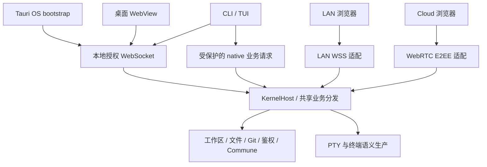

# 00 — 系统总览

Ridge 的业务 Runtime 运行在独立 Kernel 进程。桌面、CLI/TUI、LAN 与 Cloud 连接同一 Host，服务持有工作区拓扑、PTY、业务持久化与 Commune 状态。职责依据见[统一 Runtime](../../specs/l2-unified-client-runtime.md)。

| 实现 | 当前职责 |
| --- | --- |
| [ridge-kernel](../../packages/ridge-kernel/src/lib.rs) | 独立进程、Host、领域服务、PTY、LAN/Cloud 生命周期 |
| [ridge-core](../../packages/ridge-core/src/lib.rs) | 无 Tauri 的业务逻辑与能力校验 |
| [ridge-remote](../../packages/ridge-remote/src/lib.rs) | Remote 传输、鉴权与服务适配 |
| [ridge-term](../../packages/ridge-term/src/lib.rs) | 终端语义生产/消费与展示能力 |
| [ridge-cli](../../packages/ridge-cli/src/main.rs) | TUI、仪表盘与无图形启动入口 |
| [桌面 shell](../../src-tauri/src/lib.rs) | OS 集成与受限 Runtime bootstrap |
| [共享前端](../../packages/remote/src/shared/) | 业务 RPC、终端消费与传输适配 |

客户端退出仅 detach。Runtime 冷启动产生新代际，已终止的 PTY 不因恢复布局而复活。CHG-069 收敛终端语义，CHG-070 迁出桌面业务所有权，CHG-088 统一 CLI 初始创建。旧模块见 [CHG-070 归档](../archive/CHG-070/)，旧导览见[本轮归档](../archive/CHG-089/architecture/00-overview.md)。
